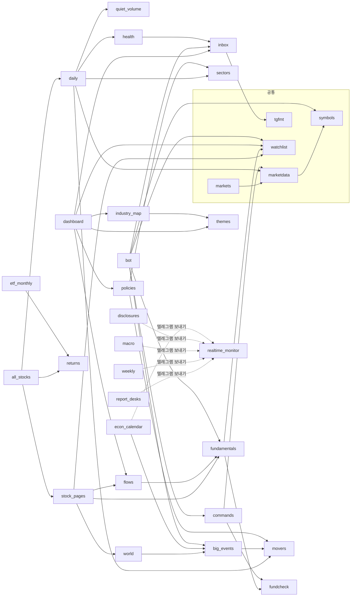
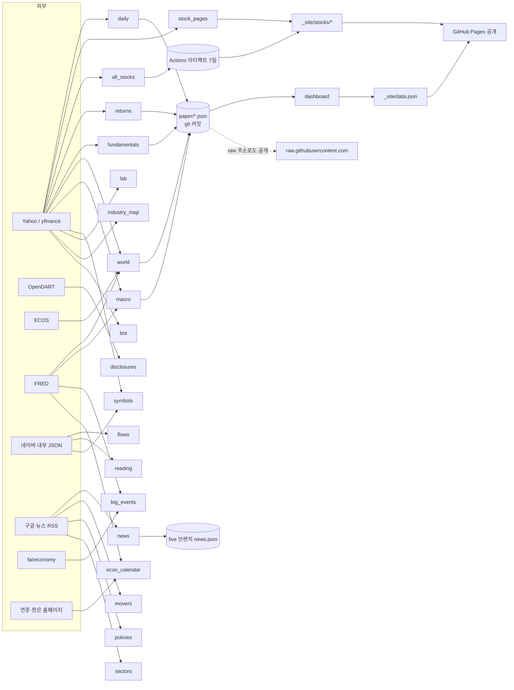
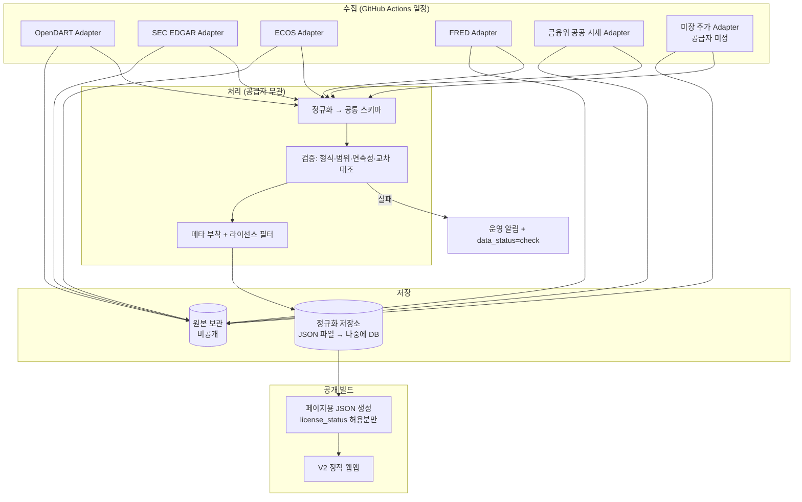
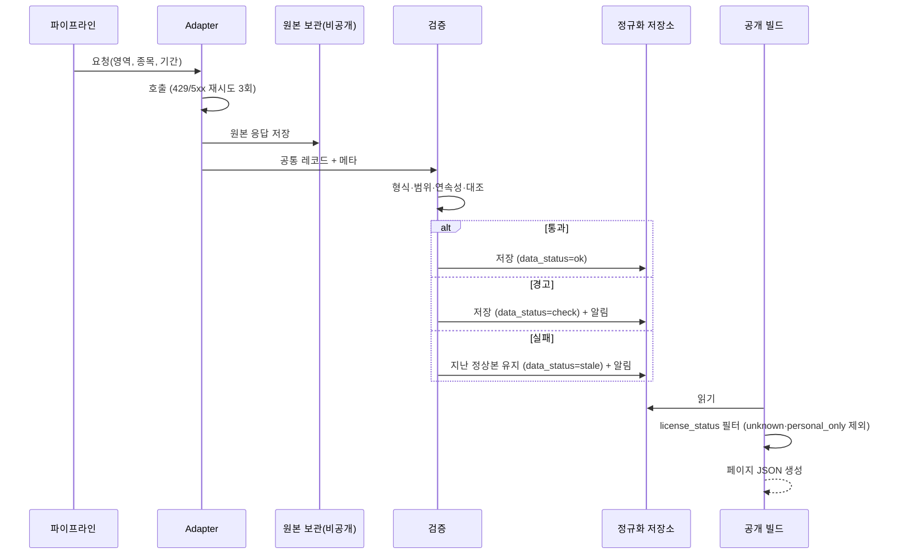
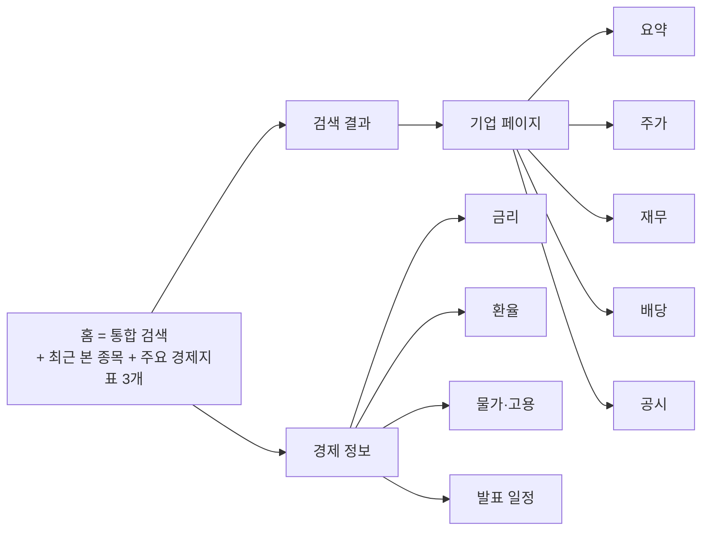

# 이지스톡 V2 아키텍처 설계 및 기존 코드 분석 (2026-10-31)

- 범위: **분석과 설계만.** 코드 수정·삭제·이동, API 키 발급, 가입·결제·계약, Pages 설정 변경, `main` 수정, 이력 변경, PR 없음.
- 기준 코드: `develop-v2` `151c877` (= `main` `d6627d6` + 문서). 코드 파일은 두 브랜치가 같아요.
- 앞 문서: [01 수익화 진단](../business/01-strategy-2026-10-31.md) (브랜치 `claude/project-thread-vyvmp6`에만 있음), [02 공급자 진단](../business/02-data-provider-audit-2026-10-31.md), [03 이전 위험 검토](../business/03-data-migration-risk-review-2026-10-31.md), [V2 README](README.md).
- 이 문서의 자리: V2 설계 문서 세트(README의 01~10)가 나오기 전에 쓴 **기초 분석서**예요. 05 데이터·06 시스템·07 공급자·10 로드맵 문서가 이 문서의 해당 장을 이어받아요 (README 문서 지도 참고).

## 표기 규칙

| 표시 | 뜻 |
|---|---|
| **[코드]** | 이번에 저장소 파일을 직접 열어 확인한 사실 (파일 경로를 같이 적음) |
| **[문서02]·[문서03]** | 앞 문서의 조사 결과. 앞 문서에서 [공식·발췌]·[2차]였던 것은 그 등급을 그대로 유지 |
| **[제안]** | 이 문서의 설계 제안. 아직 결정 아님 |
| **[추정]** | 근거는 있지만 확인 안 됨 |
| **확인 필요** | 공식 원문·서면 확인이 없음. 사실로 쓰면 안 됨 |

> 이번 작업 환경은 공급자 사이트(sec.gov·opendart·krx·tiingo 등) 접속이 막혀 있어 **약관 원문을 새로 확인하지 못했어요.** 라이선스 판단은 전부 앞 문서 등급을 따르고, 새로 확정한 것은 없어요.

---

## 0. 결론 먼저

1. **V2는 "새 화면 + 새 데이터 층"으로 만들고, V1 코드는 계산 함수만 골라 가져와요.** V1 화면(`site/app.js` 6,639줄, 함수 319개, 한 파일)은 리포트·신호·실험실 위주라 V2의 5개 영역(검색·주가·기업/재무·배당·경제)과 구조가 안 맞아요. 반면 검색 알고리즘, SVG 차트, 수익률·배당 계산, 디자인 토큰, 고장 감시는 재사용 가치가 있어요 [코드].
2. **가장 중요한 새 부품은 "공급자 Adapter → 공통 스키마 → 검증 → 메타" 파이프라인**이에요. 02 문서의 "yfinance DataFrame 모양을 흉내 내는 Adapter"는 V1 이전용으로는 맞지만, V2 기준으로는 **부족해요** — 통화·회계기간·수정주가·배당 날짜를 표 모양이 담지 못해요. V2는 **공통 레코드(JSON 스키마)를 기준**으로 하고, V1 호환이 필요하면 그 위에 얇은 변환기를 둬요 [제안].
3. **월 5만 원으로 되는 것: 국내외 재무·공시(DART·EDGAR), 경제지표(ECOS·FRED 일부), 국장 일봉(금융위 공공 시세, 이용허락범위 확인 필요).** **안 되는 것: 미장 주가의 공개 웹 표시**(확인된 공급자 없음), 세계 지수, 애널리스트 목표가, 실시간 [문서02·03].
4. V1·V2 분리는 **같은 저장소 안 디렉터리 분리(`v2/`)** 로 시작하되, 공개 저장소에 원본 데이터가 쌓이는 V1 방식은 **V2에서 하지 않아요** (데이터는 커밋하지 않고 배포 산출물로만) [제안]. 저장소 이사 여부는 사용자 결정(12장 D1).
5. 개발 시작 전 사용자 결정이 꼭 필요한 것: **저장소·호스팅 방침, 미장 주가 처리, 국장 하루 늦은 시세 감수, 견적 메일 발송, 초기 범위에서 뉴스·공시 포함 여부** (12장).

---

## 1. 프로젝트 현황 요약

| 항목 | 현황 | 근거 |
|---|---|---|
| 형태 | 정적 PWA + GitHub Actions 자동 작업. 서버·DB·로그인 없음 | [코드] `site/`, `.github/workflows/*.yml` |
| 화면 | `site/index.html`(49줄) + `site/app.js`(6,639줄, 함수 319개, 모듈 없음) + `style.css`(1,173줄) + `sw.js` | [코드] |
| 데이터 생산 | 루트 파이썬 36개(약 8,200줄), 워크플로 13개 | [코드] `wc -l *.py` |
| 데이터 저장 | `paper/` 103개 파일을 git에 커밋, 뉴스만 `live` 브랜치, 전 종목 일봉은 Actions 아티팩트(7일) | [코드] `find paper`, `news.yml`, `all-stocks.yml` |
| 배포 | `pages.yml`: `dashboard.py` → 아티팩트에서 전 종목 파일 풀기 → `stock_pages.py` → `industry_map.py` → `upload-pages-artifact`·`deploy-pages` | [코드] `.github/workflows/pages.yml` 43~71행 |
| 주 공급자 | Yahoo(yfinance) — 18개 파일에서 직접 호출, `query1.finance.yahoo.com` 직접 요청 2곳 | [코드] 2-5절 |
| 테스트 | `tests/` 32개 파일, 테스트 함수 173개, `test.yml`에서 pytest | [코드] |
| 사용자 상태 | 브라우저 localStorage 72곳 | [코드] `grep -c localStorage site/app.js` |
| 비용 | 0원 (공개 저장소 Actions 무료, 유료 API 없음) | [문서01] |
| 메타 | `updated`·`day`·`asof`만. `source`·`adjustment`·`license_status`·`data_status` 없음 | [코드·문서02] |

---

## 2. 기존 코드 구조 분석

### 2-1. 디렉터리 구조 [코드]

```
-2easy-stock/
├─ *.py (36개)            데이터 수집·가공·리포트·봇 (모두 루트에 평평하게)
├─ site/                  화면 (index.html, app.js, style.css, sw.js, manifest, fonts/Pretendard, icons/)
├─ paper/                 커밋되는 자료 (JSON 76개 + inbox 29개)
│  ├─ kr/ us/             daily.json, fundamentals.json, flows.json(kr)
│  ├─ symbols/            kr.json, us.json, *_returns.json, lab.json, etfm/ (48개)
│  └─ *.json              world, macro, events, calendar, sectors, report, weekly, reading, policies …
├─ tests/                 pytest 32개 (test_search_js.py는 JS 검색도 대조)
├─ docs/                  backup/(메모 백업), business/(02·03), v2/(README, 이 문서)
├─ .github/workflows/     13개
├─ data/, _site/          .gitignore — 실행 중에만 생김 (CSV, 배포 폴더)
└─ requirements.txt       requests, websockets, python-dotenv, pandas, numpy, yfinance (버전 고정 없음)
```

### 2-2. 진입점과 화면 구성 [코드: `site/index.html`, `site/app.js` 514~535행]

- 진입점: `index.html` → `app.js` 하나. `load()`(318행)가 `data.json`을 받아 전역 `DATA`에 넣고, `render()`(606행)가 `VIEWS[screen](d)`로 화면 전체를 `innerHTML`로 다시 그려요.
- 화면(`VIEWS`): `home`, `report`, `watch`, `tools`, `chart`, `stock`, `search`, `map`, `inbox`, `world`, `more`. 아래 메뉴는 홈·리포트·관심·도구·차트, 위에 검색·산업 지도·국장/미장 탭, 오른쪽 메시지함.
- 도구 탭(`PERF_TABS`, 2540행): 적립식 계산기·포트폴리오 실험실·수익률 달력·폭락 대비·목표.
- 종목 화면(`stock`): 머리 카드, 재무 점검(`checkCard`), 종목 공시, 업종, 차트, 수급(국장), 재무제표.

### 2-3. 파이썬 모듈 의존성 [코드: 파일별 `import` 조사]



눈여겨볼 점
- **`realtime_monitor.py`(KIS 실시간 시험용)가 텔레그램 발송 함수(`send_telegram`·`send_html`)의 공급처**예요. `disclosures`·`econ_calendar`·`macro`·`report_desks`·`weekly`가 여기서 가져와요 [코드: 각 파일 `from realtime_monitor import`]. → V2에서 이 파일을 버리면 알림 경로도 같이 정리해야 해요.
- `markets.py`가 `marketdata.py`의 종목 목록(`UNIVERSE`)을 끌어 써서, 설정과 Yahoo 수집이 한 덩어리예요 [코드: `markets.py` 3~8행].
- `world.py`가 `big_events.py`를 import(FRED 함수 재사용) → 세계 지수 수집이 큰 발표 모듈에 묶여 있어요.

### 2-4. 데이터 수집·가공 흐름 [코드: 워크플로 + 각 파일]



### 2-5. Yahoo / yfinance 직접 의존 전수 [코드: `grep yfinance|yf.|finance.yahoo`]

| 파일:행 | 호출 | 받는 것 | 수정주가 | 사용 목적 | V2 판단 |
|---|---|---|---|---|---|
| `marketdata.py:77` | `Ticker.history(start)` | 대형주·지수 일봉 | `True` | 국장·미장 기본 종목 CSV(`data/*.csv`) | 공급자 교체 |
| `daily.py:107` | `Ticker.history` | 지수 일봉 캔들 | `False` | `daily.json` `candles` | 공급자 교체 |
| `daily.py:130` | `Ticker("KRW=X").history` | 원/달러 | 기본 | `daily.json` `usdkrw` | ECOS로 |
| `stock_pages.py:43` | `Ticker.history(period="max")` | 상장일부터 일봉 | `False` | 종목 화면 차트·세계 지수 파일 | 공급자 교체 (기간 축소 가능성) |
| `all_stocks.py:39` | `yf.download(…, group_by="ticker")` | 전 종목 2년 일봉 + 월봉 | `False` | 전 종목 차트·조건 검색 | **V2 초기 제외 후보** (데이터셋 배포) |
| `returns.py:111` | `yf.download(1mo, max, actions=True)` | 월봉 + `Dividends` + `Adj Close` | 둘 다 | 10년 수익률·배당률·MDD·배당 달 | 배당 영역 핵심 → 교체 |
| `etf_monthly.py` | `returns.fetch` 재사용 | ETF 월 수익률 | 수정 | 실험실 | 폐기 |
| `lab.py:51` | `yf.download(1mo)` | 17개 자산 월봉 | `True` | 포트폴리오 실험실 | 폐기 |
| `fundamentals.py:164` | `Ticker.info/.income_stmt/.quarterly_*` | 재무·PER·PBR·배당률·목표가·실적일·배당락일 | — | 재무제표·종목 화면 | **DART·EDGAR로 재작성** |
| `fundcheck.py:22, 92` | `Ticker.info`, `.calendar` | ROE·부채비율·실적일 | — | 재무 등급 | 계산식으로 대체 |
| `sectors.py:154` | `Ticker.info` | industry·sector | — | 업종 분류 | KRX 업종·SIC로 |
| `symbols.py:431, 450` | `YfData`, `EquityQuery/ETFQuery` + `query1.finance.yahoo.com` | 전 종목·ETF 목록 | — | 검색 목록 | 금융위 상장종목·SEC 목록 |
| `industry_map.py:236, 253` | `yf.download`, `YfData` + `query1.finance.yahoo.com` | 테마 대표 종목 일봉, 시총 | `True` | 산업 지도 | 폐기 |
| `world.py:77` | `Ticker.history` | 세계 지수·환율·원자재·VIX·BTC | `True` | 세계 지수 | Yahoo 부분 폐기, ECOS·FRED 부분 유지 |
| `macro.py:63` | `Ticker.history` | ^TNX·^IRX·CL=F·KRW=X·HYG 등 | `True` | 경기 국면 경고 | FRED·ECOS 대체 가능분만 |
| `big_events.py:280` | `history(5m)` | 선물·지수 5분봉 | `False` | 지수 급변 알림 | 폐기 (실시간 제외) |
| `bot.py:346, 353` | `history(5d)`, `history(5m)` | 일봉·5분봉 | `False` | 텔레그램 가격 알림 | 폐기 |
| `commands.py:60` | `history(2y)` | 2년 일봉 | `True` | 봇 '종목' 명령 | 폐기 |

→ 수정주가 기준이 `True`/`False`로 섞여 있어 **같은 종목이 화면마다 다른 기준**일 수 있어요 [코드]. V2는 공통 스키마에서 이 기준을 필드로 명시해요(7장).

### 2-6. 그 밖의 외부 호출 위치 [코드: URL 조사]

| 공급자 | 파일 | 비고 |
|---|---|---|
| OpenDART | `disclosures.py` | 키 `DART_API_KEY`, 공시 목록 |
| ECOS | `world.py` `ecos_get()` | 키 `ECOS_API_KEY`, 국고채 |
| FRED | `world.py`, `macro.py`, `big_events.py`, `econ_calendar.py` | 키 없는 CSV·HTML |
| 네이버 | `flows.py`(`m.stock.naver.com`), `reading.py`(`stock.naver.com`), `symbols.py`(`finance.naver.com`) | 비공식 |
| 구글 뉴스 RSS | `news.py`, `movers.py` (+ `policies.py`·`sectors.py` 경유) | |
| faireconomy | `big_events.py` | 비공식 피드 |
| 연준·한은 홈페이지 | `econ_calendar.py` | HTML 파싱 |
| KIS | `realtime_monitor.py` | 수동 시험용 |
| 텔레그램·GitHub API | `bot.py`, `health.py`, `realtime_monitor.py` | 알림·실행 기록 |

### 2-7. 저장 위치와 프론트 읽기 경로 [코드: `site/app.js` `fetch(` 12곳]

| 앱이 읽는 파일 | 행 | 만드는 곳 |
|---|---|---|
| `data.json` | 318 | `dashboard.py` (paper/ 합본) |
| `raw.githubusercontent.com/…/live/news.json` | 250 | `news.py` |
| `stocks/<시장>/_quotes.json` | 1026 | `all_stocks.py` |
| `stocks/<시장>/<코드>.json` | 5240 | `all_stocks.py` → `stock_pages.py`가 덮어씀 |
| `symbols/<시장>.json`, `symbols/<시장>_returns.json` | 1297, 3994 | `symbols.py`, `returns.py` (`dashboard.py`가 `copytree`) |
| `symbols/etfm/*.json`, `symbols/lab.json` | 6328, 6352 | `etf_monthly.py`, `lab.py` |
| `indexes/<기호>.json` | 3825 | `stock_pages.build_indexes` |
| `themes.json`, `industry.json`, `inbox.json` | 1677, 1881, 1328 | `themes.py`, `industry_map.py`, `inbox.py` |

앱은 공급자 이름을 모르고 JSON 모양만 알아요. 다만 출처 문구 "야후" 글자가 `index.html` 35행과 `app.js` 14곳에 있어요 [코드].

### 2-8. 기능별 데이터 의존성 요약

| 기능 | 데이터 | 공급자 |
|---|---|---|
| 검색 | 종목 목록 | Yahoo 스크리너 + 네이버 ETF 이름 |
| 종목 차트 | 일봉 OHLCV | Yahoo |
| 재무제표·재무 점검 | 손익·자본·`info` | Yahoo |
| 공시 | 공시 목록 | DART |
| 배당(적립식 계산기·배당 달) | 월봉 배당·수정 종가 | Yahoo |
| 세계 지수·환율·금리 | 지수·환율·금리 | Yahoo + ECOS + FRED |
| 경기 국면 | 금리·유가·하이일드·VIX 등 | Yahoo 5개 + FRED |
| 경제 일정 | FOMC·금통위·발표 일정 | 연준·한은 홈페이지, faireconomy, FRED |
| 수급 | 외국인·기관 | 네이버 |
| 뉴스·리서치 | 기사 제목, 리포트 목록 | 구글 뉴스, 네이버 |
| 리포트(국장·미장·주간) | 위 전부 가공 | 혼합 |

---

## 3. 기존 기능 유지·개선·폐기 목록

판단 기준: ① V2 5개 영역(검색·주가·기업/재무·배당·경제)에 속하나 ② 추천·신호·예측·복잡한 포트폴리오·장식이 아닌가 ③ 라이선스 확인 가능한 데이터로 돌릴 수 있나 ④ 코드가 공급자와 분리돼 있나.

### 3-1. 유지 (그대로 또는 거의 그대로 가져갈 수 있음)

| 파일 경로 | 현재 기능 | 데이터 의존성 | 재사용 | 수정 필요성 | 판단 근거 |
|---|---|---|---|---|---|
| `symbols.py` 46~380행 (`norm`, `chosung`, `spell`, `query_tokens`, `score`, `search`) | 너그러운 검색 (초성·오타·별명) | 없음 (목록만 입력) | ✅ | 낮음: 목록 원천만 바꿈 | 순수 함수, `tests/test_symbols.py`·`test_search_js.py`가 지킴 [코드] |
| `site/app.js` 1190~1300행 (JS 검색 `chosung`, `scoreOf`) | 화면 검색 | `symbols/*.json` | ✅ (코드 복사) | 낮음 | 파이썬과 같은 규칙, 테스트로 대조됨 [코드] |
| `disclosures.py` (수집·분류 부분) | DART 공시 목록 | OpenDART | ✅ | 중간: 알림 발송(`realtime_monitor`) 분리, 메타 추가 | 이미 공공 API [코드] |
| `health.py` `check_data`, 워크플로 실패 알림 패턴 | 데이터 빈칸·지연 감시 | 자체 | ✅ | 중간: 값 검증(이상값) 추가 | V2 검증 층의 출발점 [코드] |
| `site/style.css` 디자인 토큰, `site/fonts/` Pretendard | 색·글꼴 | 없음 | ✅ | 낮음 | Pretendard 라이선스 파일이 `site/fonts/`에 없음 → **확인 필요**(SIL OFL로 알려짐 [추정]) |
| `site/sw.js` | 캐시 재검증 | 없음 | ✅ | 낮음 | 오래된 화면 문제 해결한 패턴 [코드] |
| `dashboard.py` `stamp_assets`, `site_version` | 파일 해시로 캐시 깨기 | 없음 | ✅ (함수 단위) | 낮음 | [코드] 98~118행 |

### 3-2. 개선 (구조나 데이터 연결을 바꿔서 가져감)

| 파일 경로 | 현재 기능 | 데이터 의존성 | 재사용 | 수정 필요성 | 판단 근거 |
|---|---|---|---|---|---|
| `symbols.py` `fetch`·`screen`·`naver_etf_names` | 전 종목 목록 수집 | Yahoo 스크리너, 네이버 | △ (출력 형식만) | 높음: 금융위 KRX상장종목정보·SEC 티커 목록으로 | 출력 `[코드,이름,시장,종류,별명]`은 좋음, 원천이 문제 [코드·문서02] |
| `stock_pages.py` | 종목별 JSON(캔들+재무+수급) | Yahoo, `fundamentals`, `flows` | △ | 높음: 공통 스키마 기반으로 새로 조립 | 주가 페이지의 뼈대 역할 [코드] |
| `daily.py` | 지수 캔들, 대형주 요약, 많이 오른/내린 종목 | Yahoo | △ | 높음: Adapter 경유, 리포트용 부분 제거 | 주가 영역 '시장 요약' 후보 [코드] |
| `marketdata.py` `rsi`, `volatility`, `breadth`, `wide_kr/us` | 지표 계산, 종목 범위 | `download`가 Yahoo | △ | 중간: `download` 버리고 계산 함수만 | 계산은 순수 함수 [코드] |
| `returns.py` | 10년 연 상승률·배당률·MDD·위기 낙폭·배당 달 | Yahoo 월봉 `Dividends`·`Adj Close` | △ | 높음: 배당 이벤트 스키마 입력으로, 배당락일 없을 때 처리 | 배당 영역 핵심 계산, 원가격/수정가격을 나눠 쓰는 설계는 맞음 [코드·문서01] |
| `fundamentals.py` | 재무 요약 JSON | Yahoo `info`·재무표 | △ (`summarize` 출력 모양) | **매우 높음**: `fetch`를 DART·EDGAR별로 새로, `asof`를 '수집일'→'기간 끝'으로, 통화 맞추기 | `asof`가 수집일(152행), `currency` 확인 없이 `cap/net` [코드: 135~160행] |
| `fundcheck.py` | ROE·부채비율·PER 점수로 '재무 등급' | Yahoo `info` | △ (계산식만) | 높음: 지표는 직접 계산, **등급(점수)은 V2에서 빼는 것 권장** | 등급은 평가·추천처럼 읽힐 수 있음(01 문서 D2) [제안] |
| `sectors.py` | Yahoo 업종 → 한국어 15개 | Yahoo `info` | △ (매핑 구조) | 높음: KRX 업종·SEC SIC 매핑표 | 기업 정보에 업종 필요 [코드] |
| `world.py` `ecos_get`·`ecos_rates`, FRED 부분 | 국고채, 미국 금리 | ECOS, FRED | ✅ | 중간: Yahoo 부분(지수·원자재) 분리·삭제, `big_events` 의존 끊기 | 경제 영역 핵심 [코드] |
| `macro.py` `fred()`·`us_economy()` | 미국 실업률·물가 등 | FRED | ✅ (수집) | 중간: '경기 국면 판정' 문장은 해석이라 빼고 지표 표시로 | 판정·경고는 V2 정보 제공 원칙과 경계 [제안] |
| `econ_calendar.py` | FOMC·금통위·발표 일정 | 연준·한은 HTML, FRED | △ | 중간: HTML 수집 약관 **확인 필요**, 일정 스키마로 | 경제 영역 '일정' 후보 [코드] |
| `learn_cases.py`/`app.js` 용어집 (3097행~) | 용어 설명 | 자체 작성 | △ | 낮음: 페이지별 '쉬운 설명' 툴팁으로 | 초보자 설명 자산 [코드] |
| `app.js` SVG 차트 (`trendCard` 3851행, 종목 차트, 이동평균 설정) | 캔들·선 차트 | 일봉 JSON | △ | 중간: 모듈로 떼어 내기 | 외부 라이브러리 없이 동작 [코드] |
| `tests/` | V1 테스트 | — | ✅ (V1 보호) | V2용 새 테스트 별도 | V1 회귀 방지 |

### 3-3. 폐기 (V2에 가져가지 않음 — V1에는 그대로 남음)

| 파일 경로 | 현재 기능 | 데이터 의존성 | 판단 근거 |
|---|---|---|---|
| `report_desks.py`, `weekly.py`, `inbox.py` | 오늘의 리포트·주간 리포트·메시지함 | 혼합 | 리포트가 "볼 업종·종목"을 골라 줌 → 추천으로 보일 소지(01 D2). V2 범위 밖 |
| `bot.py`, `commands.py`, `tgfmt.py`, `watchlist.py` | 텔레그램 봇·가격 알림 | Yahoo 5분봉 | 1인용, 실시간 성격 |
| `realtime_monitor.py` | KIS 실시간 시험 | KIS | 실시간 제외. 단 `send_telegram` 의존 끊기 필요(2-3절) |
| `big_events.py` (급변 감지·faireconomy) | 큰 발표·지수 급변 | faireconomy, Yahoo 5분봉 | 비공식 피드 + 실시간 성격. FRED 실제값 함수만 경제 영역에서 재검토 |
| `flows.py` | 외국인·기관 수급 | 네이버 내부 JSON | 수집 약관 위험 [문서01] |
| `reading.py` | 증권사 리서치 목록·요약 | 네이버 | 요약문 저작권 [문서03] |
| `news.py`, `movers.py`(뉴스), `policies.py` | 뉴스·움직인 이유·정책 | 구글 뉴스 RSS, 손 정리 | 라이선스 확인 필요, 초기 범위 밖 (08 문서에서 재검토) |
| `industry_map.py`, `themes.py` | 산업 연관 지도, 테마 100개 | Yahoo + 자체 | 장식·탐색 기능, Yahoo 시총 의존. 테마 사전은 검색 별명으로 일부 재검토 가능 |
| `lab.py`, `etf_monthly.py` | 포트폴리오 실험실 | Yahoo | '복잡한 포트폴리오 관리' 제외 |
| `all_stocks.py` | 전 종목 일봉 배포 | Yahoo | 사실상 데이터셋 배포 [문서03]. V2 초기엔 대형주·요청 종목만 |
| `quiet_volume.py` | 조용한 거래량 | Yahoo | 신호 성격 |
| `app.js` 홈·리포트·도구·지도·메시지함 화면, 적립식 계산기·폭락 대비·목표 | V1 화면 | 혼합 | V2 화면은 새로 설계(9장). 계산기는 V2 범위 밖 — 01 문서가 차별점으로 본 기능이라 **폐기 여부는 사용자 확인 필요**(12장 D9) |

---

## 4. V2 권장 아키텍처

### 4-1. 원칙 [제안]

1. **화면은 공급자를 모른다.** 화면은 공통 스키마 JSON만 읽어요.
2. **공급자 코드는 Adapter 안에만.** 수집·변환·재시도를 공급자별 파일에 가둬요.
3. **모든 값에 메타.** 출처·기준일·수집 시각·통화·수정 기준·라이선스 상태·데이터 상태.
4. **원본은 공개하지 않는다.** 원본 응답은 비공개 저장 영역(처음엔 Actions 아티팩트, 나중엔 비공개 저장소·객체 저장소)에, 공개 쪽엔 라이선스가 허락한 가공본만.
5. **라이선스 상태가 `unknown`인 데이터는 공개 빌드에서 자동으로 빠진다** (빌드 단계 차단).
6. **정적 사이트로 시작, 서버는 필요해질 때.** 단 스키마·저장 구조는 DB로 옮기기 쉽게.

### 4-2. 시스템 구조



### 4-3. 계층별 책임

| 계층 | 책임 | 하지 않는 것 |
|---|---|---|
| Adapter | 공급자 호출, 인증, 한도·재시도, 원본 저장, 공급자 형식 → 공통 레코드 변환 | 화면용 계산, 다른 공급자 참조 |
| 검증 | 스키마 검사, 이상값, 결측, 기준일 지연, 공급자 간 대조 | 값 고치기(표시만) |
| 서비스(가공) | 지표 계산(PER·배당수익률·수익률), 통화 환산, TTM | 공급자 호출 |
| 공개 빌드 | 페이지 단위 JSON, 라이선스 필터, 출처 문구 | 수집 |
| 화면 | 요약/상세 표시, 출처·기준일 표시 | 계산 대부분 |

---

## 5. V2 디렉터리 구조

### 5-1. 제안 [제안]

```
-2easy-stock/ (develop-v2)
├─ (V1 그대로: *.py, site/, paper/, tests/, .github/workflows/*.yml)   ← 손대지 않음
└─ v2/
   ├─ README.md
   ├─ core/                    공급자 무관 공통
   │  ├─ schema/               공통 스키마 (JSON Schema 파일 + 파이썬 dataclass)
   │  ├─ meta.py               메타 블록 생성·검사
   │  ├─ validate.py           검증 규칙
   │  ├─ calendar.py           거래일·회계기간 유틸
   │  └─ fx.py                 통화 환산 (ECOS·FRED 환율 레코드 사용)
   ├─ adapters/                공급자별 한 폴더
   │  ├─ base.py               Adapter 인터페이스, 재시도·한도·원본 저장 공통
   │  ├─ opendart/  sec_edgar/  ecos/  fred/  fsc_price/  (us_price_<공급자>/ 나중)
   │  └─ registry.yaml         데이터 영역 × 시장 → 사용할 Adapter, 라이선스 상태
   ├─ services/                계산 (V1에서 골라 옮김: 검색·수익률·배당·지표)
   ├─ pipelines/               실행 단위 (prices_daily.py, financials_weekly.py, macro_daily.py …)
   ├─ build/                   공개 JSON 생성 + 라이선스 필터
   ├─ web/                     V2 화면 (index.html, js/ 모듈, css/)
   ├─ tests/                   V2 테스트 (Adapter는 저장된 원본 표본으로 오프라인 테스트)
   └─ licenses/                공급자별 약관 확인 기록 (원문 날짜·캡처 경로·결론)
.github/workflows/v2-*.yml     V2 전용 워크플로 (V1 워크플로와 이름·트리거 분리)
```

### 5-2. 배포·운영 관점

| 주제 | 제안 | 이유 |
|---|---|---|
| V1 영향 차단 | V2 워크플로는 `develop-v2`에서만 돌고 `paper/`·`site/`를 안 건드림. V1 `pages.yml`은 `main` 기준 그대로 | 같은 저장소라도 브랜치·경로로 분리 |
| V2 미리보기 배포 | **확인 필요**: 한 저장소의 GitHub Pages는 사이트 하나라 V1과 동시에 못 올림 [추정]. 후보: (a) V2는 Actions 아티팩트 + 캡처 검수만 (b) 별도 저장소의 Pages (c) Cloudflare Pages 등 외부 무료 호스팅 — **(b)(c)는 가입·설정이라 사용자 결정** | Pages 설정 변경 금지 |
| 데이터 커밋 | V2는 수집 결과를 **git에 커밋하지 않음**. 정규화 저장소는 아티팩트·캐시(처음) → 비공개 저장소 또는 객체 저장소(나중) | 03 문서의 '이력에 원본이 남는 문제' 재발 방지 |
| 비밀값 | Secrets 이름 앞에 `V2_` (예: `V2_DART_API_KEY`), V1과 같은 키를 쓸지 결정 필요 | 회수·교체 시 V1 영향 차단 |
| 상업 운영 | GitHub Pages는 상업 SaaS 금지 [문서01] → 상업 오픈 전 호스팅 이전 필요 | 12장 D2 |
| 서버·DB 도입 | 정규화 저장소를 "테이블 하나 = 스키마 하나"로 설계 → SQLite/Postgres로 그대로 옮김. 서버가 생기면 `build/`가 API 응답 생성기로 바뀜 | 화면은 JSON 모양만 알게 유지 |

---

## 6. 데이터 Adapter 설계

### 6-1. 인터페이스 [제안]

```python
class Adapter:
    provider: str            # "opendart", "sec_edgar", "ecos", "fred", "fsc_price" …
    domains: set[str]        # {"price_daily", "financials", "dividends", "company", "macro", "filings"}
    license: LicenseInfo     # registry.yaml에서 읽음 (status, 출처 문구, 허용 범위)

    def fetch_raw(self, request) -> RawResponse      # 호출 + 원본 저장 (비공개)
    def normalize(self, raw) -> list[Record]          # 공통 스키마 레코드
    def health(self) -> AdapterHealth                 # 한도 남은 양, 마지막 성공 시각
```

- **V1 호환 Adapter(02 문서의 `prices.py`)는 별도 '호환 층'**: 공통 레코드 → yfinance 모양 DataFrame. V1 이전이 필요할 때만 쓰고 V2 코드는 안 씀.
- 왜 DataFrame 흉내를 기준으로 삼지 않나: DataFrame 한 장엔 ① 통화 ② 수정 기준 ③ 배당 기준일·지급일 ④ 회계기간 시작·끝 ⑤ 정정 여부 ⑥ 출처가 들어갈 자리가 없어요. 03 문서 2-4절의 차이 9가지 중 6가지가 이 정보예요 [문서03].

### 6-2. 데이터 유형별 정의

#### (1) 주가 (일봉)

| 항목 | 내용 |
|---|---|
| 공급자 원본 | 금융위 주식시세정보: 날짜 문자열(`basDt` 예 20261030), 종가·시가·고가·저가·거래량·시가총액·상장주식수 등 행 단위 [문서03, 항목 목록 확인 필요]. 미장 공급자는 미정 |
| 공통 형식 | `PriceBar` (7장) — **원가격 저장이 기본**, 수정가격은 저장하지 않고 `CorporateAction`으로 계산 |
| 변환·검증 | 숫자 변환, 날짜 → ISO, 거래소 달력과 대조해 빠진 날 확인, 고가≥max(시,종)·저가≤min, 0·음수 금지, 전일 대비 ±30% 초과는 분할·병합 이벤트와 대조 |
| 누락 | 빠진 거래일은 채우지 않음(보간 금지). `data_status: "partial"` + 빠진 날 목록 |
| 오류·재시도 | 지수 백오프 3회(2·4·8초), 429/5xx만 재시도, 4xx는 즉시 실패 기록. 실패 시 **지난 정상본 유지 + `stale`** |
| 출처 | 레코드마다 `source.provider`, `source.dataset`, 응답 저장 경로 |
| 기준일·갱신 | `as_of`(거래일), `collected_at`(UTC), `published_at`(공급자 게시 시각, 금융위는 다음 영업일 13시 이후 [문서02 공식·발췌]) |

#### (2) 기업 기본정보

| 항목 | 내용 |
|---|---|
| 원본 | DART 기업개황(`corp_code` 8자리, 법인명, 업종 코드, 결산월 등 [항목 확인 필요]), 금융위 KRX상장종목정보, SEC `company_tickers`·submissions(CIK, SIC, 회계연도 끝) |
| 공통 형식 | `Company` + `Listing`(한 회사 여러 상장 가능) |
| 변환 | 식별자 매핑표: 종목코드 ↔ `corp_code`, 티커 ↔ CIK. 매핑 실패는 검색 결과에서 '상세 정보 준비 중' |
| 누락 | 업종 없음 → `sector: null` + 화면 "분류 없음" |
| 갱신 | 주 1회 + 상장·상폐 반영 [제안] |

#### (3) 재무제표

| 항목 | 내용 |
|---|---|
| 원본 | DART `fnlttSinglAcntAll`: 계정 1개 × 보고서 1개 행, 금액 문자열(쉼표), `reprt_code`(11013·11012·11014·11011), `fs_div`(CFS/OFS), 당기 3개월·누적 [문서03, 2차]. EDGAR companyfacts: `facts.us-gaap.<개념>.units.USD[]`, `start·end·fy·fp·form·filed` [문서03, 2차] |
| 공통 형식 | `FinancialStatementItem` (계정 표준 키 + 기간 + 연결/별도 + 통화 + 회계기준) |
| 변환 | ① 계정 매핑표(DART `account_id`/한글명, EDGAR 개념 후보 목록 → 표준 키 `revenue`·`operating_income`·`net_income`·`total_equity` …) ② 누적 → 3개월 풀기 ③ **4분기 = 연간 − 1~3분기** ④ 같은 기간 여러 제출(정정) → 최신 `filed` ⑤ 연결 우선, 없으면 별도 + 표시 |
| 검증 | 자산 = 부채 + 자본(허용 오차), 분기 합 ≈ 연간, 부호 이상, 전년 대비 ±1000% |
| 누락 | 매핑 안 된 계정은 빈칸(`null`) + `missing_reason`. 다른 계정으로 **추정해 채우지 않음** |
| 갱신 | 정기보고서 제출 시즌에 매일, 그 외 주 1회 [제안] |

#### (4) 배당

| 항목 | 내용 |
|---|---|
| 원본 | DART 배당 사항(정기보고서 항목, 결산 기준 1주당 배당금 [문서02: API 항목 확인 필요]), DART 공시 중 '현금·현물배당 결정'(기준일·지급 예정일 포함 가능 [추정]), 미장은 주가 공급자 배당 이력(미정) 또는 EDGAR(배당 일정은 구조화돼 있지 않을 가능성 [추정]) |
| 공통 형식 | `DividendEvent` — 선언일·배당락일·기준일·지급일을 **각각 별도 필드**, 없으면 `null` |
| 변환 | 한국: 2023년 이후 배당 절차 개선(배당액 확정 후 기준일 지정 가능)으로 회사마다 기준일이 다를 수 있음 [추정, 확인 필요] → 연말 기준일 가정 금지 |
| 검증 | 지급일 ≥ 기준일, 금액 > 0, 통화 일치 |
| 누락 | 배당락일 모르면 배당수익률 계산은 '최근 12개월 지급 합'이 아니라 '회계연도 기준'으로 바꾸고 화면에 기준 표시 |

#### (5) 경제지표

| 항목 | 내용 |
|---|---|
| 원본 | ECOS `StatisticSearch`(통계표 코드·항목 코드·주기·기간, 값 문자열) [코드: `world.py` `ecos_get`], FRED CSV(`DATE`, 시리즈 값, 결측 `.`) [코드: `macro.py` `fred()`] |
| 공통 형식 | `MacroObservation` + `MacroSeries`(단위, 주기, 계절조정 여부, 원 저작권자) |
| 변환 | 결측 `.`·빈 문자열 → `null`, 단위 정규화(%, 지수, 원/달러), 주기 표시 |
| 검증 | 날짜 단조 증가, 개정값(같은 날짜 값 변경) 기록 |
| 라이선스 | FRED는 **시리즈마다 원 저작권자 조건이 다름** [문서02] → 시리즈 단위로 `license_status` |

#### (6) 공시

| 항목 | 내용 |
|---|---|
| 원본 | DART 공시 목록(`rcept_no`, `corp_code`, 보고서명, 접수일) [코드: `disclosures.py`], EDGAR submissions(`accessionNumber`, `form`, `filingDate`) |
| 공통 형식 | `Filing` — 제목·종류·접수일·원문 링크만, **원문 복제 안 함** |
| 갱신 | DART 평일 매시(지금과 같음) |

### 6-3. 반드시 다룰 문제와 해결 위치

| 문제 | 해결 | 위치 |
|---|---|---|
| **통화 차이** | 모든 금액 필드에 `currency`(ISO 4217). 비율(PER 등)은 **분자·분모 통화가 같을 때만** 계산, 다르면 같은 날 환율(`FxRate`)로 환산하고 `fx_source` 기록. V1은 통화 확인 없이 나눔 [코드: `fundamentals.py` `summarize`] | `core/fx.py`, services |
| **회계연도·분기 차이** | `fiscal_year`, `fiscal_period`(FY·Q1~Q4·H1), `period_start`, `period_end`를 따로. 화면은 "2025 회계연도(2025-07~2026-06)"처럼 기간 표기. 달력 분기로 억지 정렬 안 함 | schema, Adapter |
| **수정주가 vs 비수정주가** | 원가격 + `CorporateAction`(분할·병합·배당) 저장 → 수정가격은 계산. 레코드에 `adjustment: "raw"`. 화면·수익률마다 어떤 기준인지 표시. 공급자가 수정가격만 줄 때는 `adjustment: "split+div"`로 별도 저장하고 섞지 않음 | services, validate |
| **분할·배당 처리** | 분할: 비율 + 효력일. 국장 분할 정보 무료 원천은 **확인 필요**(DART '주식분할 결정' 공시 파싱 가능 [추정]). 분할 미반영 의심(±30% + 공시 없음) → `data_status: "check"`, 화면에 "확인 중" | validate |
| **배당락일 vs 지급일** | `ex_date`·`record_date`·`pay_date` 분리. 수익률 계산은 `ex_date` 기준, 현금흐름 표시는 `pay_date` 기준. 하나만 있을 땐 다른 날짜를 추정하지 않음 | schema |
| **국내외 회계 기준 차이** | `accounting_standard`: `K-IFRS`·`K-GAAP`·`US-GAAP`·`IFRS`. 표준 계정 키는 공통이지만 **비교 화면엔 기준이 다르면 경고** | schema, 화면 |
| **결측치·데이터 지연** | `data_status`: `ok`·`partial`·`stale`·`check`·`unavailable`. `expected_by`(기대 갱신 시각) 넘기면 `stale`. 국장 공공 시세는 하루 늦음을 '지연'이 아니라 **정상 기준일**로 표시 | meta, validate |

### 6-4. 처리 흐름



---

## 7. 공통 데이터 스키마 초안 [제안]

모든 레코드에 붙는 메타 블록:

```json
"meta": {
  "source": { "provider": "opendart", "dataset": "fnlttSinglAcntAll", "url": "…", "raw_ref": "raw/opendart/2026-10-31/…json" },
  "as_of": "2026-09-30",
  "collected_at": "2026-10-31T09:10:00Z",
  "published_at": null,
  "currency": "KRW",
  "adjustment": "raw",
  "license_status": "public_attribution",
  "attribution": "출처: 금융감독원 전자공시시스템(OpenDART)",
  "data_status": "ok",
  "schema_version": "0.1"
}
```

| 필드 | 값 | 비고 |
|---|---|---|
| `license_status` | `public_attribution`(출처 표시로 공개 가능) · `licensed_display`(계약상 표시 허용) · `internal_only` · `personal_only` · `unknown` | **공개 빌드는 앞의 둘만** |
| `data_status` | `ok` · `partial` · `stale` · `check` · `unavailable` | |
| `adjustment` | `raw` · `split` · `split+div` · `n/a` | |

핵심 엔터티 (필드 요약)

| 엔터티 | 키 | 주요 필드 |
|---|---|---|
| `Instrument` | `instrument_id`(예 `KR:005930`, `US:AAPL`) | `market`, `ticker`, `name_ko`, `name_en`, `type`(stock·etf·reit·index), `exchange`, `currency`, `listed_on`, `delisted_on`, `aliases[]`, `company_id` |
| `Company` | `company_id`(예 `KR-DART:00126380`, `US-CIK:0000320193`) | `name`, `country`, `sector_code`, `sector_scheme`(KRX·SIC), `fiscal_year_end_month`, `accounting_standard` |
| `PriceBar` | `instrument_id` + `date` | `open`, `high`, `low`, `close`, `volume`, `value_traded?`, `market_cap?`, `shares_out?`, `adjustment` |
| `CorporateAction` | `instrument_id` + `type` + `effective_date` | `type`(split·reverse_split·bonus·rights), `ratio`, `source_filing_id` |
| `DividendEvent` | `instrument_id` + `record_date|ex_date` | `amount_per_share`, `currency`, `declared_date`, `ex_date`, `record_date`, `pay_date`, `kind`(cash·stock·special), `fiscal_year` |
| `FinancialStatementItem` | `company_id` + `statement` + `item_key` + `period_end` + `basis` | `statement`(IS·BS·CF), `item_key`(표준 키), `value`, `currency`, `unit`(1·1000·1e6), `fiscal_year`, `fiscal_period`, `period_start`, `period_end`, `basis`(consolidated·separate), `accounting_standard`, `filed_at`, `is_restated`, `source_item`(원 계정명·태그) |
| `MacroSeries` / `MacroObservation` | `series_id` / + `date` | 단위·주기·계절조정·원 저작권자 / `value`, `revision` |
| `FxRate` | `pair` + `date` | `rate`, `source` |
| `Filing` | `filing_id` | `company_id`, `form`, `title`, `filed_at`, `url` |

계산 결과(PER, PBR, 배당수익률, ROE 등)는 `DerivedMetric`로 따로 저장하고 `inputs[]`(어떤 레코드로 계산했는지)와 `formula` 이름을 남겨요 — "숫자가 왜 이렇게 나왔나"를 화면에서 보여 줄 수 있게.

---

## 8. 데이터 라이선스 위험

> 아래는 [문서02·03] 등급을 그대로 옮긴 것이에요. **새로 확인한 원문은 없어요.** "가능"이라 적힌 칸도 공식 원문이 아니면 계약·공개 전 재확인 대상이에요.

| 공급자 | 개인 사용 | 상업적 이용 | 웹 표시 | 원본 저장 | 가공 데이터 제공 | 제3자 재배포 | 보관·삭제 의무 |
|---|---|---|---|---|---|---|---|
| Yahoo / yfinance | 개인 라이선스 [문서02 공식·발췌] | 서면 허락 필요 [문서02 공식·발췌] | 확인 필요 (V2 사용 안 함) | 확인 필요 | 확인 필요 | 불가로 봐야 함 [추정] | 확인 필요 |
| OpenDART | 가능 [추정] | **확인 필요** (공공데이터라 가능성 높음 [추정]) | 확인 필요 | 확인 필요 | 확인 필요 | 확인 필요 | 확인 필요 |
| 한국은행 ECOS | 가능 | 공공데이터포털 '이용허락범위 제한 없음' 표기 [문서02 공식·발췌], ECOS 자체 약관 **확인 필요** | 확인 필요 (출처 표시 조건 가능성) | 확인 필요 | 확인 필요 | 확인 필요 | 확인 필요 |
| 금융위 주식시세정보(공공데이터포털 15094808) | 가능 [추정] | **확인 필요** (이용허락범위 칸 미확인) | 확인 필요 | 확인 필요 | 확인 필요 | 확인 필요 | 확인 필요 |
| KRX Open API | 비상업만 [문서02 2차] | 불가로 봐야 함 | 사전 허락 없는 공표 금지(홈페이지 데이터) [문서02 공식·발췌] | 확인 필요 | 출처 표기 조건 [2차] | 금지 [2차] | 확인 필요 |
| KRX·코스콤 정식 계약 | — | 계약 | 계약 | 계약 | 계약 | 계약 | 계약 (요금 비공개) |
| SEC EDGAR | 가능 | 공공 정보 재사용 가능 [문서02 공식·발췌] | 가능 [문서02 공식·발췌] | 가능 [추정] | 가능 [추정] | 가능 [문서02 공식·발췌] | 확인 필요. 접근 시 User-Agent 선언·초당 10회 [공식·발췌] |
| FRED | 가능 | 공공 시리즈는 출처 표시로 가능, **제3자 저작권 시리즈는 허락 필요** [문서01] | 시리즈별 확인 필요 | 확인 필요 | 시리즈별 | 시리즈별 | 확인 필요 |
| Tiingo | 가능 | 내부 상업 이용만 [문서02 공식·발췌] | 별도 문의 | 확인 필요 | 확인 필요 | 금지(별도 계약) [공식·발췌] | 확인 필요 |
| 사용자 자기 Tiingo 키 방식 | — | 운영자가 배포 안 하면 문의 불필요 [문서02 공식·발췌] | 사용자 화면에서만 | 운영자 저장 안 함 | — | — | CORS 등 **확인 필요** |
| 네이버·구글 뉴스·faireconomy | V2 사용 안 함 | 위험 [문서01·03] | — | — | — | — | — |
| Pretendard 글꼴 | 가능 [추정] | SIL OFL로 알려짐 [추정] — 저장소에 라이선스 파일 없음, **확인 필요** | — | — | — | — | — |

구조상 위험 (공급자와 별개)
- **정적 사이트 = 브라우저가 JSON을 통째로 받음.** "화면 표시" 허락만으로는 부족할 수 있어요. 계약 질문에 "클라이언트로 전달되는 JSON 파일 허용 여부"를 꼭 넣어야 해요 [문서03].
- **공개 저장소 이력**: V1 Yahoo 원본이 169커밋·74개 브랜치에 남아 있어요 [문서03]. V2를 같은 저장소에서 키워도 이 위험은 그대로예요 (12장 D1).
- **GitHub Pages 상업 SaaS 금지** [문서01].
- **유사투자자문업**: 유료 + 투자 판단 정보 조합이면 신고 대상 가능 [문서01]. V2 '정보 제공·추천 없음' 원칙이 이 위험을 줄이지만 법률 확인은 **확인 필요**.

---

## 9. 화면 및 페이지 구조 [제안]

원칙: 첫 화면은 검색. 각 페이지는 **"요약(초보자) → 상세(펼치기·탭)"** 2단. 모든 숫자 칸 아래 작은 글씨로 `출처 · 기준일`. 장식 대시보드·실시간 흉내·추천 문구 없음.



| 영역 | 기본 요약 (처음 보이는 것) | 상세 데이터 (펼치거나 탭) |
|---|---|---|
| 1. 통합 검색 | 검색창(초성·오타 허용), 결과에 시장·종류·현재 제공 범위 배지("재무만", "주가 하루 늦음") | 별명·영문명 일치 이유, 상장폐지 종목 |
| 2. 주가 정보 | 최근 종가·기준일, 1년 선 차트, 52주 최고·최저, 시가총액 | 일·주·월 캔들, 기간 선택, 이동평균(설정), 거래량, 수익률(원가격/수정 기준 표시), 원본 표 내려받기 **없음**(라이선스) |
| 3. 기업 정보·재무 | 한 줄 소개(업종·결산월·회계기준), 매출·영업이익·순이익 5년 막대, 핵심 지표 4개(PER·PBR·ROE·부채비율)와 쉬운 설명 | 손익·재무상태·현금흐름 표(연·분기, 연결/별도 전환), 계산식 보기(`DerivedMetric.inputs`), 원 공시 링크 |
| 4. 배당 정보 | 최근 1주당 배당금, 배당수익률(기준 명시), 최근 5년 배당 추이 | 배당 이벤트 표(선언·배당락·기준·지급일), 배당성향, 통화 |
| 5. 경제 정보 | 기준금리·국고채 3년·원/달러·미국 10년·미국 CPI 카드 (값·기준일·전기 대비) | 시리즈별 장기 차트, 발표 일정, 시리즈 설명·원 저작권자 |

공통: 아래 메뉴는 **검색 · 경제 · 내 목록(최근 본·관심, 기기 저장)** 3개 정도로 최소화. 국장/미장은 탭이 아니라 검색 결과·기업 페이지 안에서 자연스럽게 구분. V1 화면 규칙(버튼 눌러도 위치 고정, sticky 금지)은 이어 쓰기 [메모 ui-no-jump-rule].

미장 주가 라이선스가 없을 때: 미국 기업 페이지는 **재무·배당·공시만** 보이고 주가 탭에 "주가는 준비 중이에요 (라이선스 확인 중)" 표시. 미장 PER·배당수익률은 주가가 필요해서 **같이 빠짐** — 재무 원본 값(EPS, 1주당 배당금)만 표시.

---

## 10. 비용 및 운영 계획

### 10-1. 월 5만 원 조건에서 가능한 범위

| 영역 | 국내 | 미국 | 근거 |
|---|---|---|---|
| 기업 기본정보·검색 | ✅ 0원 (DART·금융위 상장종목, 약관 확인 필요) | ✅ 0원 (SEC, ETF 목록은 빠질 가능성 [추정]) | 문서02·03 |
| 재무제표 | ✅ 0원 (DART) | ✅ 0원 (EDGAR) | 문서02 |
| 공시 | ✅ 0원 | ✅ 0원 | 문서02 |
| 배당 | △ 0원 (DART 1주당 배당, 배당락일 원천 확인 필요) | △ (EDGAR에 구조화된 배당 일정 없음 [추정]) | 문서02·03 |
| 경제지표 | ✅ 0원 (ECOS) | △ 0원 (FRED 공공 시리즈만) | 문서02 |
| 일봉 주가 | △ 0원 (금융위 공공 시세: 하루 늦음, 이용허락범위·과거 기간 확인 필요) | ❌ **5만 원 안 공개 표시 가능 확인된 공급자 없음** | 문서03 3장 |
| 세계 지수·원자재·VIX | ❌ | ❌ | 지수 사업자 라이선스 [문서03] |
| 애널리스트 목표가·예상 PER | ❌ | ❌ | 대체 없음 |
| 실시간 | ❌ (초기 범위 밖) | ❌ | |

→ **솔직한 결론: 월 5만 원으로는 "국내 주가(하루 늦음) + 국내외 재무·배당·공시·경제지표"까지.** 미장 주가는 견적 결과가 나오기 전까지 비워 두거나, "사용자가 자기 키를 넣는" 방식(Tiingo, 확인 필요)만 가능해요.

### 10-2. 운영 비용 (데이터 외)

| 항목 | 지금 | V2 상업 오픈 시 |
|---|---|---|
| 호스팅 | GitHub Pages 0원 | 상업 허용 호스팅 필요, 비용 **확인 필요** |
| 자동 작업 | 공개 저장소 Actions 0원 | 저장소를 비공개로 하면 무료 분 한도 적용 **확인 필요** |
| 원본 보관 | — | 아티팩트(보관 기간 제한) → 객체 저장소 비용 확인 필요 |
| 도메인 | 없음 | 연 1~2만 원 [문서01] |

### 10-3. 운영 일정 (초안) [제안]

| 작업 | 주기 (KST) |
|---|---|
| 국장 일봉 (공공) | 평일 14:00 이후 1회 (전 영업일 기준) |
| DART 공시 | 평일 매시 (V1과 같음) |
| 재무 | 보고서 시즌 매일, 그 외 주 1회 |
| 경제지표 | 매일 07:00 |
| 검증 리포트 | 매 수집 직후 + 주간 요약 |

---

## 11. 개발 단계별 로드맵

작업량은 Claude 작업 + 사용자 캡처 검수 기준 대략치 [추정]. 모든 단계는 `v2/<작업>` 브랜치 → `develop-v2` PR, 사용자 승인 후.

### 1단계: V2 기반 구조 구축
- 목표: `v2/` 뼈대, 공통 스키마·메타·검증 틀, V2 전용 테스트·워크플로(수동 실행만)
- 선행 조건: 12장 D1(저장소)·D2(호스팅) 방향, D10(V2 위치) 결정
- 수정할 파일: 새로 `v2/core/**`, `v2/adapters/base.py`, `v2/tests/**`, `.github/workflows/v2-test.yml`. **V1 파일 수정 없음**
- 예상 작업량: 2~3일
- 완료 기준: 스키마 JSON Schema 검사 통과, 메타 없는 레코드는 테스트 실패, V1 `pytest` 그대로 통과
- 주요 위험: 스키마를 너무 크게 잡아 진행이 늦어짐 → 6개 엔터티부터

### 2단계: 데이터 공급자 및 Adapter 구축
- 목표: OpenDART·ECOS·FRED·SEC EDGAR Adapter, 원본 보관, 재시도·한도, `registry.yaml`
- 선행 조건: **약관 원문 확인표**(공급자별 7개 항목) 사용자 폰으로 캡처·기록, V2용 API 키 등록(사용자)
- 수정할 파일: `v2/adapters/{opendart,ecos,fred,sec_edgar}/**`, `v2/licenses/*.md`, `v2/adapters/registry.yaml`
- 예상 작업량: 4~6일
- 완료 기준: 저장된 원본 표본으로 오프라인 테스트, 공급자별 `license_status`가 `unknown` 아님(아니면 공개 빌드 제외 확인)
- 주요 위험: 이 클라우드 환경에서 공급자 접속 차단 → Actions에서만 실제 호출 [메모: 클라우드 환경]

### 3단계: 기업 검색 및 상세정보
- 목표: 통합 검색 + 기업 페이지(요약·재무·공시)
- 선행 조건: 2단계, 식별자 매핑표(종목코드↔corp_code, 티커↔CIK)
- 수정할 파일: `v2/services/search.py`(V1 `symbols.py` 검색 함수 이식), `v2/services/financials.py`, `v2/pipelines/company_weekly.py`, `v2/web/**`
- 예상 작업량: 5~7일
- 완료 기준: 국장·미장 대형주 각 48개 재무가 원 공시와 일치(표본 수동 대조), 4분기 계산 테스트, 검색 테스트 V1 수준 유지, 캡처 검수 통과
- 주요 위험: DART 계정명 회사별 차이, EDGAR 개념 다양성, 금융업 계정

### 4단계: 주가 및 배당 정보
- 목표: 국장 일봉(공공), 분할·배당 이벤트, 수정가격 계산, 배당 페이지
- 선행 조건: 금융위 시세 이용허락범위·과거 기간 확인(D3), 국장 하루 늦음 감수(D4), 미장 주가 방침(D5)
- 수정할 파일: `v2/adapters/fsc_price/**`, `v2/services/{prices,dividends}.py`(V1 `returns.py` 계산 이식), `v2/web/**`
- 예상 작업량: 국장 5~7일, 미장은 공급자 결정 뒤 3~5일
- 완료 기준: 대형주 종가가 증권사 화면과 일치(표본), 분할 종목 수동 확인, 이상값 검사 0건 또는 `check` 표시, 배당 날짜 4종 구분 표시
- 주요 위험: 공공 시세 과거 기간이 짧으면 장기 차트·10년 배당률 불가, 국장 분할 정보 원천 없음

### 5단계: 경제지표
- 목표: 금리·환율·물가·고용 카드와 장기 차트, 발표 일정
- 선행 조건: FRED 시리즈별 저작권 확인, ECOS 통계 코드 목록
- 수정할 파일: `v2/adapters/{ecos,fred}/**` 확장, `v2/services/macro.py`, `v2/web/**`
- 예상 작업량: 2~3일
- 완료 기준: 시리즈마다 단위·주기·출처·기준일 표시, 개정값 기록
- 주요 위험: 일정(연준·한은 HTML) 수집 약관 확인 필요

### 6단계: 데이터 검증 및 서비스 배포
- 목표: 검증 리포트·운영 알림, 라이선스 필터 빌드, 미리보기 배포, 공개 준비
- 선행 조건: 호스팅 결정(D2), 이용약관·면책·개인정보 페이지 문안
- 수정할 파일: `v2/build/**`, `v2/core/validate.py`, `.github/workflows/v2-*.yml`
- 예상 작업량: 3~5일
- 완료 기준: 공개 산출물에 `unknown`·`personal_only` 데이터 0건, 모든 숫자 칸에 출처·기준일, 수집 실패 시 지난 정상본 + 경고, 사용자 캡처 검수 통과
- 주요 위험: 호스팅 이전 비용·작업, 공개 저장소 이력 문제 미해결 상태로 공개

---

## 12. 미결정 사항 및 사용자 확인 필요 항목

| # | 결정 | 선택지 | Claude 추천 |
|---|---|---|---|
| D1 | 저장소 방침 | 지금 저장소 그대로 / 새 공개 저장소로 V2 이사 + 옛 저장소 비공개 / 지금 저장소 비공개 | 새 저장소 이사 (03 문서와 같음). 1단계는 지금 `develop-v2`에서 시작해도 됨 |
| D2 | V2 미리보기·운영 호스팅 | 아티팩트+캡처만 / 별도 저장소 Pages / 외부 무료 호스팅 | 상업 오픈 전까진 아티팩트+캡처, 오픈 결정 때 호스팅 이전 |
| D3 | 약관 원문 확인 방법 | 사용자 폰으로 캡처 / 사이트 열리는 환경에서 Claude | 사용자 폰 캡처 (이 환경은 접속 막힘) |
| D4 | 국장 시세 하루 늦음 감수 | 감수 / 정식 계약 견적 | 감수 (일봉 중심 방침과 맞음) |
| D5 | 미장 주가 | 비워 둠 / 견적 메일 발송 / 사용자 자기 키 방식 | 처음엔 비워 두고 견적 메일 발송(외부 발송이라 승인 필요) |
| D6 | 견적 메일 발송 (Tiingo·EODData·KRX·코스콤) | 보냄 / 안 보냄 | 보냄 |
| D7 | 초기 범위에 공시 포함 | 포함(DART·EDGAR 링크만) / 제외 | 포함 — 비용 0, 라이선스 위험 낮음 [추정] |
| D8 | 초기 범위에 뉴스 포함 | 포함 / 제외 | 제외 (라이선스 원천 없음) |
| D9 | V1 적립식 계산기·폭락 대비를 V2에 넣을지 | 넣음 / 뺌 / 나중 | 나중 — 5개 핵심 영역 먼저. 01 문서가 차별점으로 본 기능이라 사용자 판단 |
| D10 | V2 코드 위치 | 저장소 안 `v2/` / 별도 저장소 | D1과 같이. 지금은 `v2/` |
| D11 | V1과 같은 API 키 공유 | 공유 / V2 전용 키 | V2 전용 키 (회수 쉬움) |
| D12 | 재무 '등급'(점수) 표시 | 유지 / 지표만 | 지표만 (추천으로 읽힐 위험) |

확인 필요 목록 (사실 확인)
1. 금융위 주식시세정보 이용허락범위·자료 시작 연도·항목(시가총액·상장주식수)
2. OpenDART·ECOS 약관의 영리 이용·출처 표시·호출 한도
3. FRED 시리즈별 저작권 (DGS10, DEXKOUS, CPIAUCSL, UNRATE 등)
4. 국장 분할·배당락일 무료 원천
5. GitHub Actions 아티팩트 공개 범위, 비공개 저장소 Actions 비용
6. 한 저장소에서 두 Pages 사이트 가능 여부
7. Pretendard 라이선스 파일
8. 유사투자자문업 해당 여부(정보 제공만 할 때) — 법률 상담
