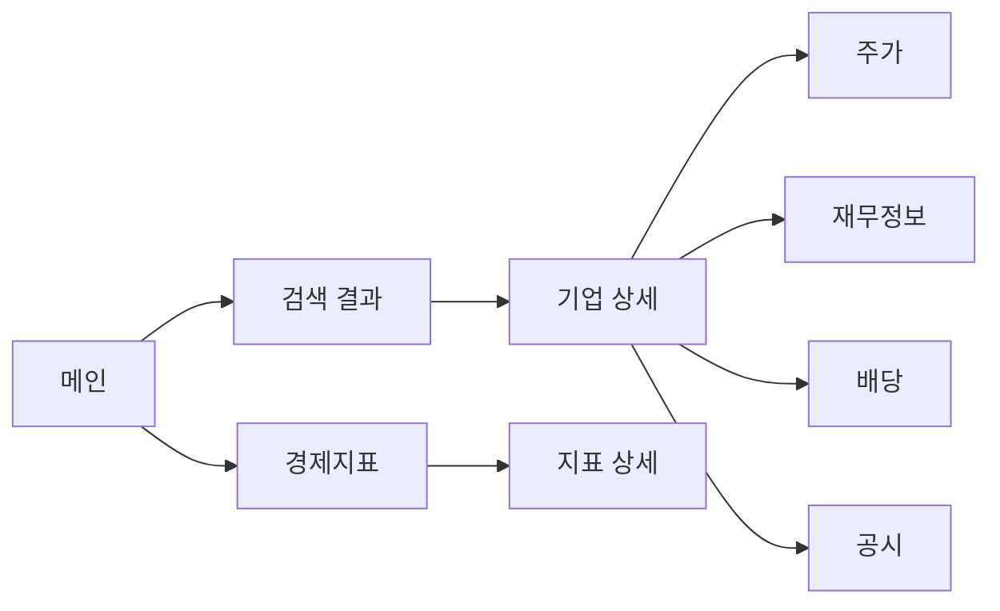

# 04 정보 구조

- 상태: 뼈대 (2026-10-31)
- 이 문서의 목적: V2의 **페이지 목록과 각 페이지에 무엇이 어디 놓이는지** 정해요.
- 책임 범위: 페이지 계층, 페이지별 요약/상세 칸 목록, 공통 메뉴·탐색, URL 규칙.
- 다루지 않는 것: 흐름과 UX 원칙 → [03](03-user-experience.md), 각 칸의 계산·예외 → [08](08-feature-specification.md), 칸이 쓰는 데이터 정의 → [05](05-data-architecture.md)

## 핵심 질문

1. 다섯 영역이 페이지로 어떻게 나뉘고 묶이나? (기업 페이지 안의 탭 vs 독립 페이지)
2. 페이지마다 "요약"에 들어가는 칸은 무엇인가?
3. 데이터 공급이 없는 칸(예: 미장 주가)은 페이지에서 어떻게 보이나?

## 페이지 지도 (초안 [제안], [기초 분석서](01-architecture-design.md) 9장)

## 목차

각 페이지는 같은 틀로 써요: **목적 / 요약 칸 / 상세 칸 / 필요한 데이터(05 엔터티 이름) / 데이터 없을 때 / 결정 필요**.

### 1. 메인 화면
- 초안: 검색창, 최근 본 회사, 주요 경제지표 3개 카드
- 결정 필요: 메인에 시장 요약(지수)을 둘지 — 지수 라이선스 확인 필요 ([07](07-data-providers.md))

### 2. 검색 결과
- 초안: 결과 줄(이름·코드·시장·종류·제공 범위 배지), 경제지표 결과 묶음

### 3. 기업 상세 페이지
- 초안 요약: 한 줄 소개(업종·결산월·회계기준), 핵심 지표 4개, 최근 실적 막대
- 탭: 주가 / 재무 / 배당 / 공시 — 탭으로 둘지 독립 페이지로 둘지 결정 필요

### 4. 주가 페이지
- 초안: 요약(종가·기준일·52주 범위·시가총액), 상세(기간별 차트, 이동평균, 거래량, 수익률 기준 표시)
- 데이터 없을 때: "주가는 준비 중이에요 (라이선스 확인 중)" [미결정 Q-06]

### 5. 재무정보 페이지
- 초안: 요약(매출·영업이익·순이익 5년), 상세(손익·재무상태·현금흐름 표, 연/분기, 연결/별도, 계산식 보기, 원 공시 링크)
- 결정 필요: 재무 등급 표시 [미결정 Q-13]

### 6. 배당 페이지
- 초안: 요약(최근 1주당 배당, 배당수익률·기준, 5년 추이), 상세(이벤트 표: 선언·배당락·기준·지급일)

### 7. 경제지표 페이지
- 초안: 카드(기준금리·국고채·환율·미국 10년·CPI 등), 상세(장기 차트, 발표 일정, 시리즈 설명·원 저작권자)
- 결정 필요: 초기 지표 목록 (FRED 시리즈별 라이선스는 07)

### 8. 공통 메뉴 및 탐색 구조
- 초안: 아래 메뉴 3개(검색·경제·내 목록), 위 영역에 검색 버튼, 공통 하단(출처 목록·면책·약관 링크)
- URL 규칙 [제안]: `#/company/KR:005930/financials` 처럼 공유 가능한 주소
- 결정 필요: 내 목록 [Q-16], 공시 탭 포함 [Q-08]

## 연결 문서

| 방향 | 문서 | 무엇을 |
|---|---|---|
| 받는 것 | 03 흐름·원칙, 05 엔터티, 07 제공 가능 여부 | |
| 주는 것 | 08 (페이지 칸 → 기능), 10 (화면 작업 단위) | |
| 결정 | decision-log | Q-06, Q-08, Q-13, Q-16 |
