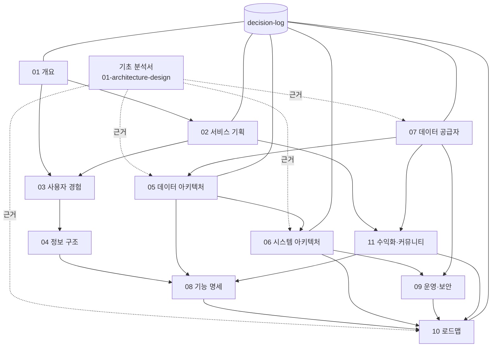

# 이지스톡 V2 설계 문서

V2 개발은 `develop-v2` 브랜치에서 해요. `main`은 V1 보존용이라 건드리지 않아요.

이지스톡 V2는 **개인 투자자를 위한 금융·기업 정보 플랫폼**이에요. 추천·신호·예측 없이, 정확한 정보를 쉽게 보여 주고 출처와 기준일을 분명히 해요.

## 브랜치 규칙

| 브랜치 | 용도 |
|---|---|
| `main` | V1 그대로 보존 (지금 사이트가 여기서 나감) |
| `develop-v2` | V2 개발 기준 브랜치 |
| `v2/<작업이름>` | V2 작업 하나씩. `develop-v2`에서 따고, PR도 `develop-v2`로 |

Claude·ChatGPT 둘 다 V2 작업은 **`develop-v2`를 기준(base) 브랜치**로 써요. `main`으로 PR을 보내지 않아요. PR 생성·병합은 사용자 승인 뒤에만 해요.

## 문서 지도

| 문서 | 한 줄 역할 | 상태 |
|---|---|---|
| [01 프로젝트 개요](01-project-overview.md) | 왜·무엇을·어디까지 (범위와 성공 기준) | 1차 확정 |
| [02 서비스 기획](02-service-planning.md) | 누구에게 어떤 가치를, 어떻게 운영·수익화 | 1차 확정 |
| [03 사용자 경험](03-user-experience.md) | 사용자가 어떻게 찾고 읽는지 (흐름·시나리오·모바일 원칙) | 뼈대 |
| [04 정보 구조](04-information-architecture.md) | 페이지 목록과 각 페이지에 무엇이 어디 놓이는지 | 뼈대 |
| [05 데이터 아키텍처](05-data-architecture.md) | 공통 데이터 모델, 수집→변환→검증→저장→갱신, 메타 | 뼈대 + 초안 연결 |
| [06 시스템 아키텍처](06-system-architecture.md) | 모듈·Adapter·저장·배포 구조, 오류 처리, 확장 | 뼈대 + 초안 연결 |
| [07 데이터 공급자](07-data-providers.md) | 공급자별 데이터·비용·라이선스(**라이선스의 유일한 상세 문서**) | 뼈대 + 초안 연결 |
| [08 기능 명세](08-feature-specification.md) | 기능별 입력·출력·예외 처리 | 뼈대 |
| [09 운영 및 보안](09-operations-security.md) | 키·갱신·모니터링·품질·백업·라이선스 관리·비용 | 뼈대 |
| [10 개발 로드맵](10-development-roadmap.md) | 단계·선행 조건·테스트·배포 기준 | 뼈대 + 초안 연결 |
| [11 수익화 모델과 커뮤니티](11-monetization-and-community.md) | 수익 모델·비용 구조·커뮤니티 전략 (**수익화·커뮤니티의 유일한 상세 문서**) | 검토안 |
| [decisions/decision-log.md](decisions/decision-log.md) | 결정 사항·미결정 사항·변경 이력 (**모든 결정의 단일 기록처**) | 시작 |
| [기초 분석: 아키텍처 설계 및 기존 코드 분석](01-architecture-design.md) | V1 코드 전수 분석, 유지·개선·폐기 목록, Adapter·스키마 초안 | 완료(2026-10-31) |

> **파일 번호 안내:** `01-architecture-design.md`는 설계 세트보다 먼저 요청받아 쓴 **기초 분석서**예요. 번호가 `01-project-overview.md`와 겹치지만 역할이 달라요. 이 분석서의 장들은 05·06·07·10 문서가 이어받고, 분석서 자체는 "근거 자료"로 남겨요. 이름을 `analysis/00-architecture-baseline.md`로 옮길지는 [결정 기록](decisions/decision-log.md) Q-01에서 정해요.

## 문서 의존 관계

읽는 순서: 01 → 02 → 03 → 04 → 07 → 05 → 06 → 08 → 09 → 10. 결정은 언제나 decision-log에서 확인해요.

## 책임 범위 (같은 내용을 두 번 쓰지 않기)

| 주제 | 상세를 쓰는 곳 | 다른 문서는 |
|---|---|---|
| 범위·제외 기능·성공 기준 | 01 | 링크만 |
| 사용자·경쟁 | 02 | 링크만 |
| 수익 모델·비용 구조·커뮤니티 | **11만** | 02·08·10은 링크 |
| 화면 흐름·UX 원칙 | 03 | 04·08은 링크 |
| 페이지별 배치 | 04 | 08은 기능 단위로만 |
| 데이터 모델·메타·검증 규칙 | 05 | 06·08은 링크 |
| 코드 구조·배포 | 06 | 09·10은 링크 |
| 공급자 비용·라이선스 | **07만** | 05·06·09는 링크 |
| 기능 입력·출력·예외 | 08 | 10은 기능 이름만 |
| 운영 절차·보안 | 09 | |
| 일정·단계 | 10 | |
| 결정·미결정 | **decision-log만** | 각 문서는 결정 번호(D-xx, Q-xx)로 참조 |

## 공통 표기

| 표시 | 뜻 |
|---|---|
| **[사실]** | 저장소 코드·공식 원문으로 확인 |
| **[가설]** | 검증해야 할 생각 |
| **[제안]** | 설계 제안, 아직 결정 아님 |
| **[결정 D-xx]** | decision-log에 기록된 결정 |
| **[미결정 Q-xx]** | decision-log의 미결정 항목 |
| **확인 필요** | 원문·서면 확인 없음. 사실로 쓰지 않음 |

## 근거 문서

- [01 수익화 진단](../business/01-strategy-2026-10-31.md) — 이 파일은 브랜치 `claude/project-thread-vyvmp6`에만 있어요 (develop-v2엔 아직 없음)
- [02 데이터 공급자 교체 진단](../business/02-data-provider-audit-2026-10-31.md)
- [03 데이터 이전 위험 검토](../business/03-data-migration-risk-review-2026-10-31.md)
- [기초 분석서](01-architecture-design.md)

## 알아 둘 위험

이 저장소는 공개라서 V1의 Yahoo 원본 데이터가 git 이력·다른 브랜치에 그대로 남아요. V2 브랜치에서 지워도 이력은 남아요. 03 문서는 "새 공개 저장소로 이사 + 옛 저장소 비공개"를 추천했고, 이건 아직 사용자 결정 대기예요 (decision-log Q-02).

## 진행 상태

- 2026-10-31: 브랜치와 문서 구조 만듦. 기초 분석서 작성. 설계 문서 세트(01~10, decision-log) 뼈대 작성. **코드 변경은 아직 없음.**
